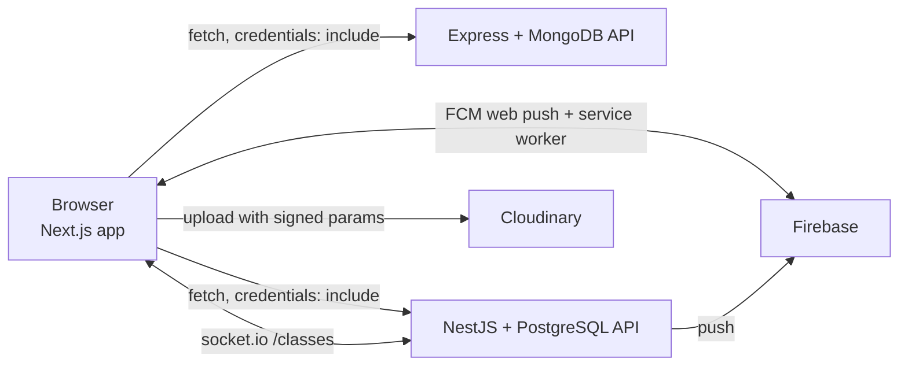

# Architecture

How the Gym Ontime frontend is organised. For setup and environment variables see the [README](../README.md); for hosting see [DEPLOYMENT.md](DEPLOYMENT.md).

## Overview

A Next.js 14 (App Router) single-page style app. It holds no secrets and no database: every piece of data comes from one of two interchangeable backends that expose the same `/api/...` routes.



## The backend switch

`src/lib/backend.ts` defines the two backends (`express`, `nest`) with their base URLs (`NEXT_PUBLIC_EXPRESS_API_URL` / `NEXT_PUBLIC_NEST_API_URL`, with localhost defaults) and keeps the visitor's choice in `sessionStorage` (`gym_backend`), so every fresh visit asks again but a page refresh does not. Every request builds its URL with `getApiUrl()` **at call time**, never from a build-time constant.

`src/components/BackendGate.tsx` is the picker. It pings the public `GET /classes` of each backend and shows a status dot: grey (checking), amber (waking up, after 3 seconds without an answer), green (online) or red (offline or no answer after 75 seconds). Free-tier hosts sleep when idle, which is why the amber state exists.

Consequences to remember: the two backends use separate databases, so an account on one does not exist on the other; locally both name their cookie `token` on `localhost`, so after switching you may need to log in again.

## Authentication

The backend sets an HTTP-only cookie at login and the browser sends it with each request (`credentials: "include"`). The frontend never reads or stores the token. The current user is held in a Zustand store (`src/store/useUserStore.ts`, read through `src/hooks/useUser.ts`). `LayoutWrapper` waits until the store says loading is finished and then redirects a logged-out visitor to `/login`, so every real user is logged in; the only anonymous call is the picker's status ping.

In production the cookie is cross-site (`SameSite=None; Secure`); see [DEPLOYMENT.md](DEPLOYMENT.md) for the browser caveat.

## Id shapes

MongoDB returns `_id`; PostgreSQL returns `id`. `src/lib/ids.ts` exports `idOf(entity)` = `entity._id ?? entity.id`, and any screen that needs an id uses it (dropdown values, React keys, comparisons). The NestJS API sends plain `id` and the frontend adapts, rather than the API imitating MongoDB. A few Mongo-shaped fields remain on purpose (notification `relatedClass`/`relatedPayment`, payment type `one-time`, numeric `amount`).

## Live seat counts (NestJS only)

`src/features/schedule/hooks/useLiveCapacity.ts` opens a socket.io connection to the `/classes` namespace of the NestJS backend and updates the seat counts when `class:capacity {classId, enrolled, capacity}` arrives (and drops a class on `class:removed {classId}`). It does nothing on the Express backend.

## Push notifications (NestJS only)

`src/lib/pushNotifications.ts` registers the browser with Firebase Cloud Messaging and sends the token to `POST /api/notifications/device-token`; it is removed on logout (`disablePush()` runs before the logout request). `PushPrompt` shows the "Turn on notifications?" card. The service worker is `public/firebase-messaging-sw.js`. Push is hidden unless all five `NEXT_PUBLIC_FIREBASE_*` variables are set and the backend is NestJS, and it only works over https or on `localhost`.

## Booking and payment

On a class card **Book Now** calls `POST /payments/initiate`, then redirects to the Paystack checkout URL. Paystack returns the browser to `/payment-success`, which calls `GET /payments/verify` with the reference. Whether a class shows **Booked** is derived from the member's payments (`schedule/hooks/useBookedClasses.ts`), not from class membership; a member removed by an admin still shows Booked (a known limitation, shared with the Express version).

## Folder layout

```
src/
  app/(routes)/      pages: login, register, dashboard, schedule, subscriptions, members,
                     admin/members, admin/trainers, payments, profile, payment-success
  features/          one folder per area (schedule, payments, subscriptions, admin, dashboard,
                     members, notifications, profile), each with components/, hooks/, types/
  components/        layout (Header, Footer, LayoutWrapper), ui primitives, BackendGate, PushPrompt
  lib/               backend.ts, ids.ts, pushNotifications.ts, cloudinaryUpload.ts, utils.ts
  store/             useUserStore.ts (Zustand)
  hooks/             useUser.ts
```

Conventions: a page file under `app/(routes)` stays thin and renders a component from `features/<area>`; data fetching lives in that area's `hooks/`; shared types live in the area's `types/`.
